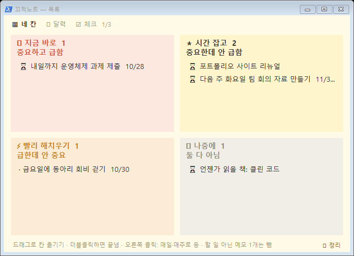
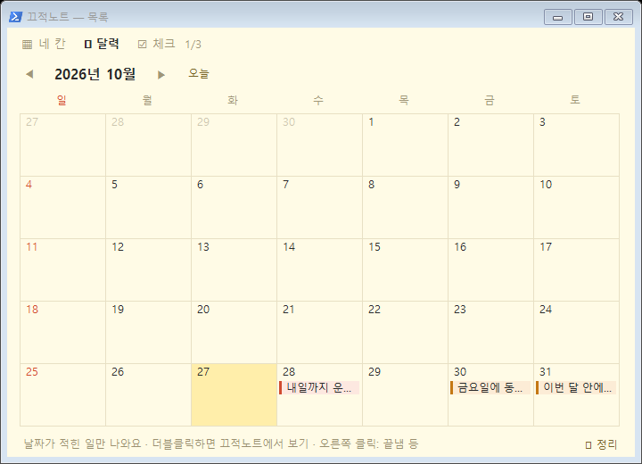
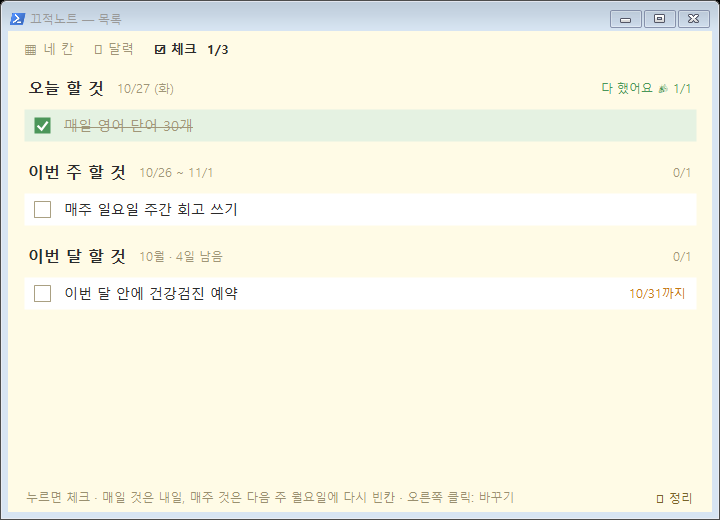

# 끄적노트

메모장처럼 막 적으면, AI가 할 일을 **중요·급함 네 칸**으로 알아서 나눠 주는 가벼운 윈도우 메모 프로그램.

- 칸을 고르거나 날짜를 입력하는 단계가 없습니다. 그냥 적으면 저장되고 정리됩니다.
- 실행 파일 하나(약 60KB)로 동작하고, 설치나 추가 런타임이 필요 없습니다 (.NET Framework 4는 윈도우에 기본으로 들어 있음).
- AI는 목록을 열 때만 부릅니다. 타자 칠 때마다 부르지 않아서 사용량이 적습니다.

| 네 칸 | 달력 | 매일·매주·이번 달 체크 |
|---|---|---|
|  |  |  |

## 설치

1. [Releases](https://github.com/HyeonSuuuuu/kkeujeok-note/releases/latest)에서 `kkeujeok-note.exe`를 내려받습니다.
2. 원하는 폴더(예: `문서\끄적노트\`)에 넣고 실행합니다. 메모와 기록은 exe 옆에 저장됩니다.
3. 처음 실행할 때 "Windows의 PC 보호" 창이 뜨면 **추가 정보 → 실행**을 누릅니다. 코드 서명을 하지 않은 exe라서 뜨는 경고입니다.
4. AI 정리를 쓰려면 아래 [AI 설정](#ai-설정)의 CLI 하나를 설치하고 로그인합니다. AI 없이도 메모는 쓸 수 있습니다.

## 쓰는 법

1. 끄적노트 창에 할 일을 한 줄씩 막 적습니다. 0.5초 동안 입력이 없으면 저장됩니다.
   - 들여쓴 줄은 윗줄의 설명으로 보고, 할 일로 따로 세지 않습니다.
2. **목록 열기**(Ctrl+E)를 누르면 AI가 새 줄을 분류합니다.
   - **네 칸**: 🔥 지금 바로 / ⭐ 시간 잡고 / ⚡ 빨리 해치우기 / 💤 나중에. 드래그해서 다른 칸으로 옮기면, 옮긴 줄은 AI가 다시 바꾸지 않습니다.
   - **달력**: "내일까지", "금요일", "다음 주 화요일"처럼 날짜가 적힌 일은 AI가 날짜로 바꿔 달력에 올립니다.
   - **체크**: "매일", "꾸준히", "매주", "이번 달 안에"처럼 되풀이하는 일은 체크 칸으로 모읍니다. 매일 할 일은 다음 날, 매주 할 일은 다음 주 월요일, 매달 할 일은 다음 달에 다시 빈칸이 됩니다.
   - 생각이나 아이디어처럼 할 일이 아닌 메모는 목록에서 뺍니다.
3. 끝낸 일은 Ctrl+D(끄적노트 창)나 더블클릭(네 칸)으로 치웁니다. 치운 일은 `기록\날짜.txt`에 남습니다. 실수로 치웠으면 ↩ 되돌리기나 Ctrl+Z로 되살립니다.

| 단축키 | 하는 일 |
|---|---|
| Ctrl+E | 목록 열기 (AI 정리) |
| Ctrl+D | 지금 줄 끝냄 / 반복하는 일이면 체크 |
| Ctrl+Z | 방금 끝낸 줄 되돌리기 |
| Ctrl+, | 설정 |
| Ctrl+T | 항상 위 |
| Ctrl+L | 기록 폴더 열기 |
| Ctrl+휠 | 글자 크기 |
| F5 (목록 창) | 다시 정리 |

## AI 설정

AI는 **질문을 표준 입력으로 받아 답을 표준 출력으로 내는 명령줄 프로그램**이면 무엇이든 씁니다. API 키를 끄적노트에 저장하지 않으며, 로그인은 각 CLI가 자체적으로 관리합니다.

⚙ 설정(Ctrl+,)에서 고릅니다.

| 고르기 | 명령 | 준비 |
|---|---|---|
| Claude Code (기본) | `claude -p --model haiku` | [Claude Code](https://claude.com/claude-code) 설치 후 로그인 |
| Codex | `codex exec --skip-git-repo-check -` | `npm i -g @openai/codex` → `codex login` |
| Gemini | `gemini -m gemini-2.5-flash` | `npm i -g @google/gemini-cli` → 처음 실행할 때 로그인 |
| 직접 입력 | 아무 명령 | 표준 입력 → 표준 출력 |

**나에 대해** 칸에 자기소개를 적으면("게임 개발 전공 4학년, 포트폴리오 준비 중" 등) AI가 무엇이 중요한지 판단할 때 참고합니다.

## 빌드

윈도우에 기본으로 들어 있는 C# 컴파일러로 빌드합니다. Visual Studio는 필요 없습니다.

```powershell
.\build.ps1          # → build\끄적노트.exe
```

`build\끄적노트.exe`를 원하는 폴더에 옮겨서 실행하면 됩니다. 데이터 파일은 exe 옆에 생깁니다.

| 파일 | 내용 |
|---|---|
| `끄적노트.txt` | 메모 본문 |
| `분류.txt` | 줄마다 AI 분류 결과 (칸, 오래 걸림·반복, 마감일) |
| `체크.txt` | 반복하는 일을 마지막으로 체크한 날 |
| `기록\yyyy-MM-dd.txt` | 끝낸 일과 체크 기록 |
| `기록\백업\` | 끌 때마다 남기는 하루 단위 백업 |
| `설정.txt` | 창 위치, AI 명령, 나에 대해 |

## 만든 방식

- C# 5 / WinForms, 소스 파일 하나 (`Kkeujeok.cs`)
- 입력창은 RichTextBox. 한글 조합 중에는 저장을 미루고(IMM), 색칠은 되돌리기(Ctrl+Z) 기록에 넣지 않습니다(TOM `Undo(tomSuspend)`).
- 달력과 체크 화면은 직접 그립니다(owner-draw).
- AI 답 형식: `번호:칸[L][D|W|M][@YYYY-MM-DD]` (예: `1:1L@2026-10-28`, `2:2D`, `3:0`)

## 라이선스

MIT
